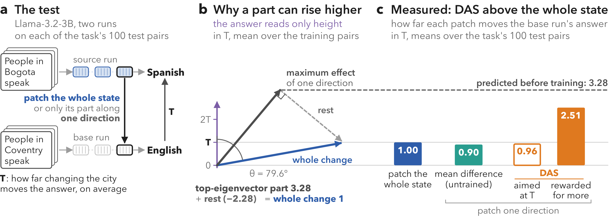

<div align="center">

# Whose Effect Is It?

**How Objectives Inflate Learned Subspace Interventions**

Toygar Tanyel · Serkan Ayvaz

[](https://arxiv.org/abs/2611.05033)
[](owneffect/)
[](lean/)
[](experiments/)
[](pyproject.toml)
[](LICENSE)

</div>

Learned interventions such as DAS often move a model's answer further than copying the whole state does. We show why, and
how to read such an effect beside the network's own.



## OwnEffect

```bash
pip install -e ".[stats]"
```

```python
from owneffect import OwnEffect

oe = OwnEffect(model, tokenizer)
oe.prepare(pairs)
rep = oe.report(layer=6, region=1, direction=d)
rep["readings"]["reading"]    # e.g. "excess": beyond the network's own interchange
```

## Repository

- [`owneffect/`](owneffect/): the library
- [`experiments/`](experiments/): experiments, scorers, task data, and how to reproduce the paper
- [`lean/`](lean/): the paper's theorems, machine-checked
- [`paper/`](paper/): the paper's figures, and the scripts that write its numbers, tables and figures from the results

## Citation

```bibtex
@misc{tanyel2026whose,
  title  = {Whose Effect Is It? How Objectives Inflate Learned Subspace Interventions},
  author = {Tanyel, Toygar and Ayvaz, Serkan},
  year   = {2026},
  eprint = {2611.05033},
  archivePrefix = {arXiv},
  primaryClass  = {cs.CL},
  doi    = {10.48550/arXiv.2611.05033},
  url    = {https://arxiv.org/abs/2611.05033}
}
```

Apache-2.0. The task data keep their sources' licences.
